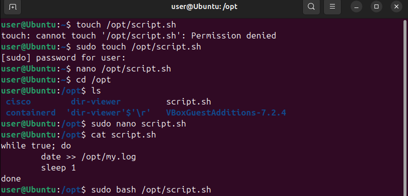
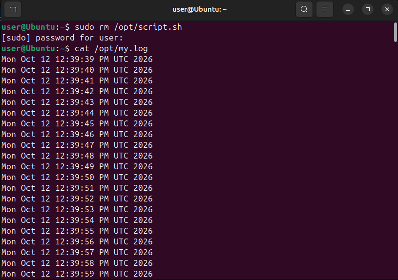
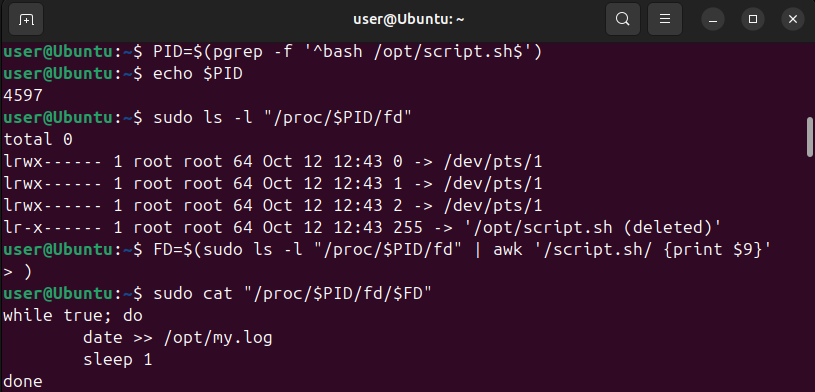
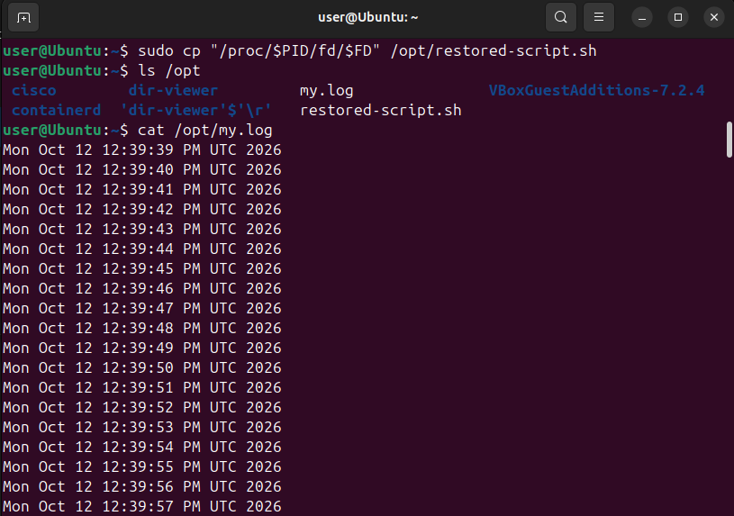
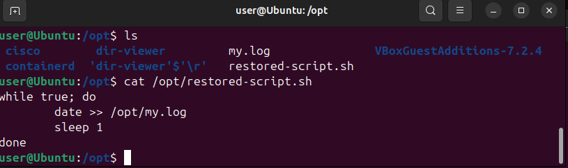

# Основы Linux: практическая работа

> Данное задание выполнено на собственной ВМ с ОС Ubuntu 24.04 LTS, а также использован GitHub в связи с недоступностью учебных ВМ и GitLab

## 1. Создание и запуск скрипта

В директории `/opt` был создан файл `script.sh` со следующим содержимым:



## 2. Удаление скрипта и демонстрация непрерывности выполнения скрипта после удаления

После запуска фонового процесса `sudo bash /opt/script.sh` файл скрипта был полностью удален из системы во втором терминале командой `sudo rm /opt/script.sh`.

Несмотря на удаление файла с диска, процесс продолжил стабильно функционировать. Это подтверждается непрерывной записью новых временных меток в лог-файл `/opt/my.log`



## 3. Механизм и способ получения содержимого удаленного файла

Для поиска и извлечения исходного кода использовалась виртуальная файловая система `/proc`, содержащая подробную информацию обо всех запущенных процессах в системе

| Этап | Выполненная команда | Описание действия |
| :--- | :--- | :--- |
| **Шаг 1** | `PID=$(pgrep -f '^bash /opt/script.sh$')` | Поиск PID работающего процесса по его командной строке |
| **Шаг 2** | `sudo ls -l "/proc/$PID/fd"` | Анализ открытых файловых дескрипторов процесса. Обнаружена ссылка `255 -> '/opt/script.sh (deleted)'` |
| **Шаг 3** | `sudo cat "/proc/$PID/fd/255"` | Чтение содержимого удаленного скрипта напрямую из дескриптора, удерживающего его процесс |



## 4. Восстановление исходного кода

Исходный код скрипта был успешно скопирован из виртуального дескриптора обратно в постоянную память файловой системы:
```bash
sudo cp "/proc/$PID/fd/255" /opt/restored-script.sh
```
Файл сохранен по пути `/opt/restored-script.sh`, его целостность и структура полностью восстановлены





